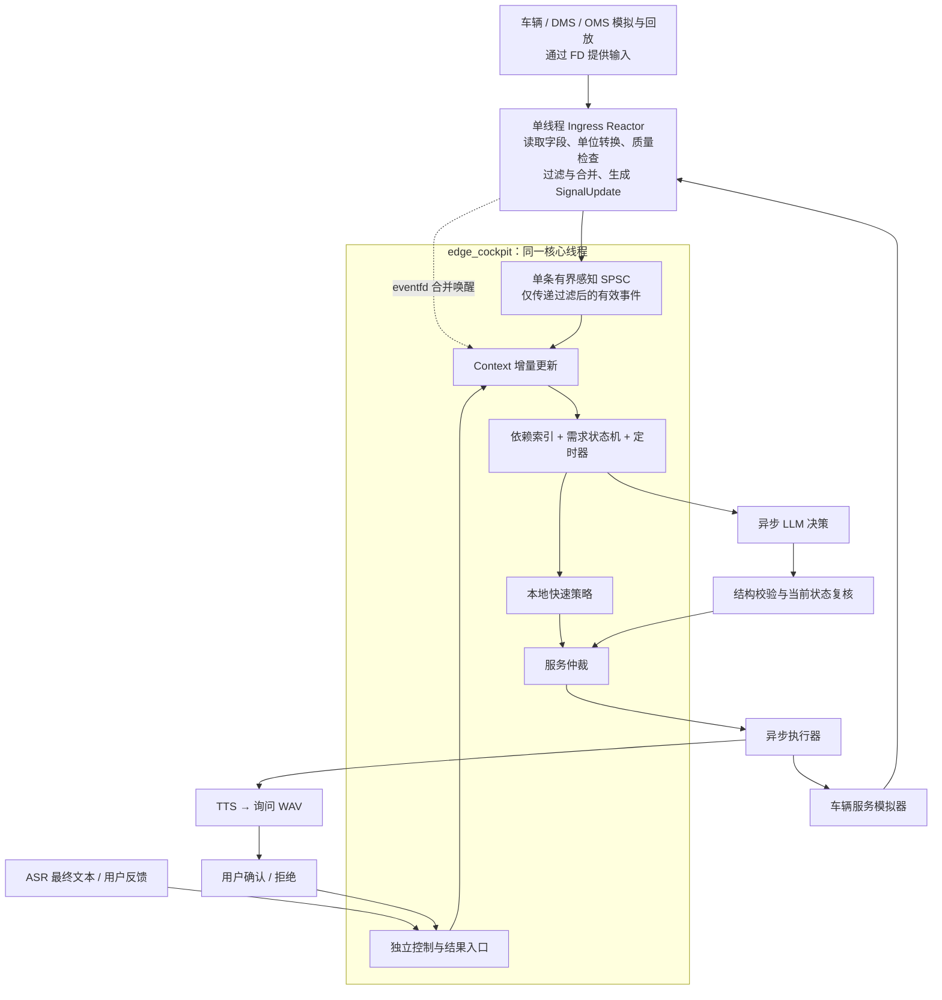

# 主动智能座舱助手改造实施计划

**一、目标与实施边界**

在现有通信框架和 ASR、LLM、TTS 三个业务节点之上，新增座舱主动服务核心，落实你在[分享会话](https://chatgpt.com/share/6ad37717-04e8-83e8-9ac0-5b057034b471)中认可的架构：

**持续维护上下文 → 按信号依赖驱动需求状态机 → 确认需求后生成决策事件 → 快慢双路径 → 服务仲裁 → 主动询问 → 用户确认 → 执行与反馈。**

首版按照已经确定的范围实施：

- 先完成 Linux 主机上的可复现闭环，再部署到 RK3588。
- 车辆和 DMS/OMS 信号通过模拟器、场景文件回放输入，预留真实数据源适配接口。
- 保留真实 ASR、真实 TTS；LLM 使用现有 mock 和 RKLLM，不新增云端后端。
- 通过 WAV 文件和文本反馈完成交互，首版不接麦克风、扬声器、唤醒和插话。
- 实现热舒适、疲劳休息提醒两条快路径，以及模糊舒适性需求一条慢路径。
- **低时延贯穿设计、实现和测试；每次决策、每次服务请求都计算时延。** 首版不设强制毫秒数门槛，10 ms 保留为快路径优化参考。
- 保留原有语音问答演示及协议兼容性。主动模式由新的配置和启动入口启用。

本次实际读取的代码位于 `/root/XJH/Edge-LLM-Comm-Infra-master`。工作副本包含已有未提交修改，构建缓存还引用搬迁前的路径。实施时先核对工作区映射，保留现有改动，使用新的构建目录建立基线；已有文档中的测试结果不能替代此次重新验证。

**二、架构与接口设计**

### 1. 进程和线程划分

新增 `edge_cockpit` 进程，现有三个模型节点继续承担推理任务。manager 保留注册、地址分配和消息路由职责。

**感知接入固定采用：一个 Ingress Reactor → 一条感知 SPSC → 一个 Context 线程。轻量回调直接在 Ingress Reactor 线程执行，不引入回调线程池。**

具体实现约束：

| 执行单元 | 职责 | 边界 |
|---|---|---|
| 单个 Ingress Reactor 线程 | 监听多个 FD，调用各来源适配器，完成解码、单位转换、质量检查、过滤、合并及感知队列入队 | 感知 SPSC 的唯一生产者；不执行状态机、模型推理或服务调用 |
| 核心线程 | Context、需求状态机、快速策略、仲裁、逻辑定时器 | 感知 SPSC 的唯一消费者；不做同步网络调用、磁盘写入或模型推理 |
| 执行器 / I/O 线程 | 请求模型节点、接收结果、调用服务模拟器 | 不直接修改 Context，不直接写感知 SPSC |
| 回放线程 | 按时间线通过 FD 生成输入，模拟突发和异常 | 复用 Ingress 的处理链路，不直接写感知 SPSC |
| 日志线程 | 输出追踪记录、时延统计和报告 | 不阻塞核心线程 |

`edge_cockpit` 继承 `StackFlow`，复用生命周期和显式请求上下文；内部新增独立运行时，**不套用现有一次只接受一个活动请求的 `VoiceTask`**。

Ingress 与核心事件循环复用现有 `network::EventLoop/Channel`。高频感知事件由 Ingress 直接写入有界 SPSC，不逐条调用内部带锁、可增长的 `queueInLoop()`。

### 2. 高频信号通路

**接入与回调执行：**

- CAN、车辆服务及其他可用 FD 统一由一个 Ingress Reactor 监听。
- 各数据源保留各自的解析和过滤函数，但这些回调均在同一个 Ingress 线程执行。
- 回调直接完成非阻塞读取、必要解码、字段读取、单位转换、质量检查、过滤和 `SignalUpdate` 生成。
- 只有过滤后需要传播的 `SignalUpdate` 才进入感知 SPSC。
- 使用非阻塞、水平触发接入，每个 FD 每轮最多处理 32 条完整消息，然后处理其他就绪来源。
- 保留每个连接的半包及解析状态。用户态缓冲区中仍有完整消息待处理时，加入 Reactor 本地待处理列表，不能只等待下一次 `epoll` 通知。

**队列与消费：**

- 使用现有 Boost 依赖中的 `spsc_queue`，感知通路只设置一条，初始容量为 1024。
- Ingress Reactor 是唯一生产者，Context 是唯一消费者。
- 用户确认、取消、模型结果和执行 ACK 保留独立控制或结果队列，避免被传感器流量挤占。
- SDK 或 ZMQ 的其他回调线程不能直接写这条感知 SPSC；需先经过接入桥接，或进入其对应的独立控制、结果通路。
- 通过 `eventfd` 合并唤醒；使用唤醒标记、消费者清除后复查队列的协议，覆盖丢失唤醒竞态。
- Context 每批最多处理 32 条已有消息，不等待凑批；批间检查控制消息和到期定时器。
- 全部逻辑定时器使用可更新、可取消的有界最小堆，由一个 `timerfd` 驱动。`eventfd` 和 `timerfd` 均可纳入文件描述符事件循环。[eventfd 文档](https://man7.org/linux/man-pages/man2/eventfd.2.html)、[timerfd 文档](https://man7.org/linux/man-pages/man2/timerfd_create.2.html)

过滤与过载策略明确区分：

| 数据类型 | 处理规则 |
|---|---|
| 连续数值 | 在不跨策略阈值、不改变质量状态时合并；保留最新值和采样时间 |
| 开关、阈值跨越、行为发生事件 | 保留有效边沿，不用最新值覆盖必要证据 |
| 重复状态采样 | 更新新鲜度，但不重复累计行为次数；保留必要的新鲜度刷新事件，避免过滤后误判过期 |
| 控制与用户反馈 | 独立排队；无法接收时明确报错 |
| 感知队列满 | 不阻塞 Ingress；可合并状态暂存在生产者自己的待发送缓存，不覆盖已入队槽位 |
| 必须保留的事件发生溢出 | 记录来源、数据缺口和计数，使受影响证据失效，等待新快照恢复 |
| 决策或执行队列满 | 明确拒绝或暂缓，不无限排队 |
| 普通调试日志拥塞 | 允许丢弃并累计计数，不影响业务线程 |

### 3. 内部数据契约

| 类型 | 必需内容 |
|---|---|
| `SignalUpdate` | 信号 ID、来源及来源代次、座位、序号、源时间与时钟域、本机接收单调时间、质量、类型化值 |
| `DecisionEvent` | 候选 ID、需求类型、代次、追踪 ID、确认时间、截止时间、相关信号版本、不可变紧凑快照 |
| `ServiceProposal` | 候选 ID、服务枚举、参数、交互模板、有效期、决策来源 |
| `ServiceAck` | 服务 ID、阶段、受理或执行结果、原因、阶段时间戳 |
| `TraceRecord` | 候选及子请求关联、阶段时间、终态、失败原因、各项时延 |

关键规则：

- 内部信号使用整数 ID 和固定类型结构；JSON 解析及文本处理放在边界和慢路径。
- Context 由核心线程唯一写入，普通状态更新不复制完整上下文。
- 状态机确认需求时，才生成相关字段的不可变快照。
- 本机计时使用统一单调时钟；外部设备时间保留用于追踪，不直接与本机单调时间相减。
- TTL 到期即使没有新事件，也必须触发失效处理。
- 慢路径结果根据候选代次、截止时间及相关信号复核；无关信号变化不使结果失效。

### 4. 外部协议与节点接入

保留 `request_id/work_id/action/object/data` 外层格式，新增以下业务对象：

| 对象 | 用途 |
|---|---|
| `cockpit.signal.batch` | 注入归一化信号批次，经接入桥接进入 Ingress |
| `cockpit.speech.file` | 提交 WAV，经 ASR 后进入座舱交互 |
| `cockpit.feedback` | 携带服务 ID 的确认、拒绝、取消或文本回答 |
| `cockpit.service.event` | 发布候选、询问、执行和终态事件 |
| `cockpit.status` | 查询当前状态、待确认服务和统计 |
| `llm.decision.request/result` | 结构化主动决策请求与结果 |
| `llm.cancel` | 取消指定请求及代次的推理 |
| `tts.utf-8` | 直接合成文本，沿用 `tts.audio.file` 完成事件 |

接入方式固定为：

- 主动模式下，ASR、LLM、TTS 不配置彼此的自动上游订阅，由座舱核心统一编排。
- 异步节点客户端复用 manager TCP 协议，连接和收发由 I/O 线程持有。
- 保留 `cockpit.signal.batch` 管理入口；来自现有 ZMQ 回调线程的信号注入，通过本地 Socket 桥接交给 Ingress，再执行统一过滤和入队。回放器直接通过 FD 输入，不在回放线程中写感知 SPSC。
- 新调用可通过可选 `ack_requested` 请求节点入队确认；旧客户端默认关闭，保持现有返回行为。
- 启动时逐节点执行订阅探测；业务请求使用超时与关联表检测丢失，不把 PUB/SUB 当作可靠投递。[ZeroMQ socket 文档](https://libzmq.readthedocs.io/en/latest/zmq_socket.html)
- 首版不自动重放结果未知的服务命令；结果超时明确结束或标记未知，避免重复执行。
- 主动候选、用户轮次和模型子请求分别编号，通过追踪 ID 关联；不能继承“最近一条传感器消息”的回包地址。
- 新客户端按请求 ID 分发并缓存异步事件，不能沿用现有 `Client.wait()` 丢弃非匹配消息的方式。

**三、主动业务、仲裁与执行规则**

### 1. 首批需求状态机

以下阈值是**可配置的演示默认值**，用于复现与测试，不视为经过真实车辆验证的业务参数。

| 场景 | 默认触发条件 | 决策及结果 |
|---|---|---|
| 热舒适 | 有乘员、空调关闭、温度 ≥28℃，并出现置信度 ≥0.8 的扇风证据；观察 800 ms；温度 ≤26℃解除热状态 | 快路径生成开启空调建议；确认后调用模拟空调服务 |
| 疲劳休息提醒 | 驾驶员在位、车辆行驶，DMS 已输出置信度 ≥0.8 的疲劳状态，并持续有效 2 s | 快路径生成休息建议；确认后模拟展示休息提示 |
| 模糊舒适性需求 | 5 s 内出现至少两次有效不适行为证据，且未命中明确快路径 | 异步 LLM 从允许服务中提出一个建议，或返回 `no_action` |

实现共享的状态转换框架：

`IDLE → OBSERVING → READY → DISPATCHED → COOLDOWN`

每个需求实例按需求类型、座位隔离证据、计时器和候选代次。通过启动时建立的“信号 → 状态机”反向索引，只评估相关需求。

- 持续条件由定时器确认，不要求恰好再来一条消息。
- 次数条件只累计不同的有效事件。
- 条件解除、数据失效或来源异常，立即撤销相关观察及未执行候选。
- 同一代候选只生成一次；冷却结束后必须重新收集证据。

### 2. 快慢路径

**快路径：** 状态机确认后，直接在核心线程执行本地策略、能力检查与仲裁，不经过 LLM 队列。询问使用预定义模板，直接请求 TTS。

**慢路径：**

- 一个活动推理，最多四个等待任务；同类候选合并，过期任务淘汰。
- 主动决策使用专用提示词和结构化输出，保持原有普通问答接口。
- 首版只允许单项服务建议或 `no_action`，不引入多步工具规划。
- 输出校验服务白名单、参数、格式和大小；解析失败不得把原始模型文本当作可执行指令。
- 模型输出不直接进入 TTS，也不能自行绕过用户确认。
- 返回结果重新检查候选有效性、当前证据、车辆能力和交互状态。
- mock 提供有效结果、无动作、非法结果、延迟、超时等确定性模式。

现有 RKLLM 的 `abort()` 会永久设置停止状态，需保留其节点关闭语义，另外实现**请求级取消**：

- 取消只作用于匹配的请求及代次。
- 取消完成后，同一模型实例可以处理下一次请求。
- 迟到的片段与完成事件被丢弃。
- SDK 取消和等待退出在模型侧完成，不阻塞座舱核心。

### 3. 服务仲裁

仲裁器与 Context 共用核心线程，检查：

- 证据有效性和服务截止时间；
- 服务能力与执行前置条件；
- 通话、忙碌、交互禁用等状态；
- 当前是否存在等待确认的服务；
- 同类重复、冷却期和最近拒绝；
- 服务优先级。

首版同时只允许一项主动询问。待处理候选最多 16 项；休息建议优先于舒适建议，同级按确认时间排序。优先级影响尚未开始的询问，首版不打断已经开始的交互。

默认参数：

- 快路径候选待发起有效期：5 s。
- 慢路径候选有效期：10 s；LLM 超时：8 s。
- 确认等待：询问 WAV 生成后开始计时，30 s。
- 成功后同类冷却：300 s；用户拒绝后：600 s。
- 所有参数集中配置，测试通过虚拟时钟验证。

### 4. 用户确认与执行闭环

服务流程使用独立状态记录：

`PROPOSED → DEFERRED / ASKING → WAITING_CONFIRMATION → EXECUTING → SUCCEEDED / FAILED / EXPIRED / CANCELLED`

- 执行器真正取走请求并登记后，产生“已受理”事件；仅入队不算执行器受理。
- TTS 生成 WAV 后，才进入等待确认状态；不将文件生成等同于用户已听到。
- 文本反馈必须指定服务 ID；确认类 ASR 文本仅能绑定当前唯一待确认服务。
- “好的”没有对应待确认服务时，不触发车控；无法明确判断的回答不作为同意。
- 执行前再次检查条件，避免用户确认时环境已经变化。
- 服务模拟器支持成功、失败、超时和重复请求注入。
- 空调模拟执行成功后发布新的车辆状态信号，Context 根据回读更新，不能在发出命令时提前认定成功。
- 重复确认、重复 ACK 不重复执行，也不重复结束服务。
- `pause` 抑制新候选，但继续维护 Context、处理反馈和超时；`exit` 撤销未执行服务并有序停止线程。
- 没有待确认服务时，用户 WAV 继续进入普通语音问答流程。

**四、分阶段实施与交付**

| 阶段 | 实施内容 | 完成标志 |
|---|---|---|
| **P0：恢复构建基线** | 核对源码目录，保留已有修改，新建构建目录；检查依赖和现有测试 | 原有三项 CTest 及语音闭环重新验证，保存本次基线 |
| **P1：事件运行时** | 新增座舱进程、数据契约、统一 Ingress Reactor、单条感知 SPSC、独立控制与结果入口、唤醒、定时器、FD 回放器和追踪模块 | 信号经统一读取、过滤、入队和核心处理到达模拟执行器，每次请求有时延记录 |
| **P2：Context 与状态机** | 从单条感知 SPSC 消费事件；实现新鲜度、来源序号、依赖索引、三类状态机、紧凑快照和快路径 | 持续观察、次数窗口、条件撤销和去重均可确定性复现 |
| **P3：主动交互闭环** | 仲裁、直接文本 TTS、ASR 接入、用户反馈、车辆服务模拟器 | 热舒适和休息提醒完成“询问→确认/拒绝→执行/结束” |
| **P4：LLM 慢路径** | 结构化决策、有限排队、结果复核、请求级取消、mock 异常模式 | 慢路径完整运行；模型慢或失败时快路径继续处理 |
| **P5：时延与异常优化** | 逐阶段测量、FD 接入公平性测试、压力测试、唤醒与批量参数调整、日志隔离、故障注入 | 产出逐次时延和分位数报告，定位并处理已发现的主要延迟来源 |
| **P6：RK 部署** | 编译座舱核心与节点、配置真实 RKLLM、板端运行相同场景 | 获得真实板端闭环和时延报告；设备未到位时明确保留此验收项 |

交付物包括：

- 可独立测试的座舱核心库与 `edge_cockpit` 可执行程序。
- 主机、RK 两套配置及服务能力表。
- 新演示客户端和三类场景回放数据。
- 单元、集成、并发及故障测试。
- 每次运行的 WAV、消息记录、决策记录、服务结果及性能报告。
- 更新后的架构说明、协议说明、启动步骤和项目约束文档。

构建增加独立的座舱开关；核心单元测试无需加载 ASR/TTS 模型。RK 阶段需要实际板卡、匹配的 `.rkllm` 权重和驱动，交叉编译成功不能代替板端验收。

**五、逐次时延计算与验收**

### 1. 每次都记录什么

每条已接收信号计算接入与处理时延并汇总；每个候选、每次服务请求保存独立的完整阶段记录。失败、拒绝、取消同样记录，未经历的阶段标记为空，不能填成 0 ms。

感知通路固定记录四个时间点：

- `t_read`：Ingress Reactor 读取到数据。
- `t_enqueue`：完成处理并成功写入感知 SPSC。
- `t_dequeue`：Context 从队列取出事件。
- `t_apply`：Context 完成状态更新。

被过滤的采样记录过滤计数及接入处理耗时，不生成不存在的队列等待或 Context 处理样本。

| 时延项 | 计算口径 |
|---|---|
| 接入处理 | `t_enqueue − t_read`，包含必要解码、单位转换、过滤及入队前处理 |
| 感知队列等待 | `t_dequeue − t_enqueue` |
| Context 状态更新 | `t_apply − t_dequeue` |
| 信号接入处理总时间 | `t_apply − t_read` |
| 观察时间 | 需求确认时间 − 开始观察时间 |
| 决策时间 | 策略完成时间 − 策略开始时间 |
| 快路径发起时间 | 执行器实际受理时间 − 候选确认时间 |
| 节点受理时间 | 模型节点入队确认时间 − 提交时间 |
| LLM 推理时间 | 有效终态时间 − 模型请求开始时间 |
| TTS 完成时间 | WAV 完成时间 − 合成请求时间 |
| 用户反馈等待 | 反馈时间 − 询问 WAV 就绪时间 |
| 服务执行时间 | 执行 ACK 时间 − 执行请求时间 |
| 整个候选生命周期 | 终态时间 − 候选开始观察时间 |

报告同时输出：

- 单次记录：需求、路径、结果、各阶段耗时、排队耗时和总耗时。
- 汇总：样本量、P50、P95、P99、P99.9、最大值。
- 运行指标：队列深度、事件年龄、合并与溢出数、过期数、CPU 和内存。
- 感知接入按数据来源分别统计，检查共享 Reactor 和队列是否导致个别来源长时间等待。
- 快路径、慢路径及不同终态分别统计，避免混合平均值掩盖问题。
- 明确标记无法观测的物理感知延迟、真实播放延迟。

### 2. 功能及异常测试

- **接入正确性：** 多个 FD 共用一个 Ingress 线程；过滤后的感知事件只由该线程入队；回放和协议注入均经过相同处理链路。
- **接入公平性：** 单个 FD 持续高频输入时，其他来源仍得到处理；半包、用户态剩余完整帧和批量限额不会造成事件滞留。
- **触发正确性：** 无关信号不驱动无关状态机；稳定条件可由定时器触发；阈值抖动不反复生成候选。
- **数据正确性：** 重复、乱序、过期、无效和来源重启；过滤不破坏行为次数与有效边沿；重复采样过滤后仍能正确维护新鲜度。
- **交互正确性：** 确认、拒绝、无响应、错误服务 ID、重复确认、条件变化后确认。
- **模型隔离：** LLM 延迟、超时、非法输出、取消后继续请求；旧结果不能恢复已取消服务。
- **执行正确性：** 受理与完成分离；失败不更新成成功状态；重复 ACK 不重复执行。
- **并发与生命周期：** 唤醒竞态、队列满且 Ingress 不阻塞、持续输入下定时器运行、退出过程中回调到达、重复 setup/exit。
- **兼容性：** 原有语音链路、请求上下文、流序号、错误传播和 RK SDK 替身测试继续通过。
- **真实主机集成：** 真实 ASR + 确定性 mock LLM + 真实 TTS；验证输出 WAV 和状态闭环。

### 3. 低时延优化与验收方式

首版直接采用短调用链、单线程轻量接入、单条感知 SPSC、单写入状态、预分配队列、合并唤醒、有界批处理和异步模型调用，不等功能完成后再整体改造。

性能测试覆盖常态输入、1 千及 1 万条/秒合成输入、突发输入、单个 FD 高频输入、慢 LLM、真实 TTS 并发和执行器拥塞。这些是测试负载，不是预先宣称的承载能力。

每次优化在同一硬件、同一场景和相同负载下比较阶段时延；根据实测调整每个 FD 的处理预算、Context 批量大小和队列配置。Ingress 热路径中的逐事件 INFO 日志改为调试或采样输出，避免日志干扰测量。绑核作为可配置优化项，默认不启用高权限实时调度或持续忙等。

**首版完成条件：三个场景闭环正确，异常有明确终态，旧功能回归通过，每次请求有可追踪的时延记录，快路径不等待慢推理，并交付有实际数据支撑的时延报告。**
