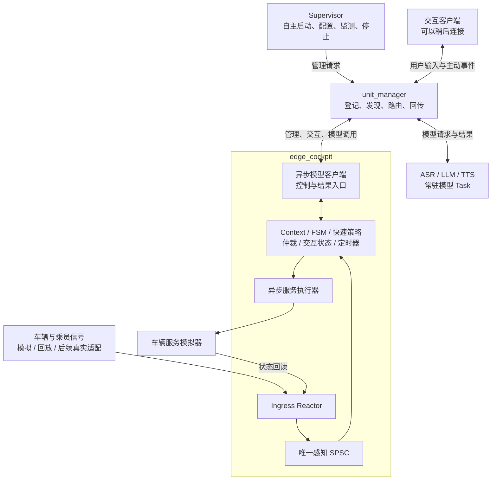

# 主动智能座舱助手改造实施计划（整合讨论版）

## 一、目标、范围与基本原则

在现有通信框架和 ASR、LLM、TTS 节点之上，新增长期运行的座舱核心及独立 Supervisor，实现：

**系统自主启动 → 持续感知车辆与乘员状态 → 更新 Context → 判断需求 → 快慢路径决策 → 服务仲裁 → 主动询问 → 用户确认 → 执行与状态回读。**

本版是原计划的完整替换方案。保留已确定的感知接入、业务场景和低时延要求，明确系统启动、任务发现、能力绑定、交互会话和请求关联。本文件为整合讨论后的独立计划文档，原计划文件保留；所述新增功能尚未实施。

### 1. 首版范围

- 先完成 Linux 主机上的可复现闭环，再部署到 RK3588。
- 车辆及 DMS/OMS 信号通过模拟器、场景文件回放输入，预留真实数据源适配接口。
- 保留真实 ASR、真实 TTS；LLM 使用现有 mock 或 RKLLM，不新增云端后端。
- 交互使用 WAV 文件和文本反馈；首版不接麦克风、扬声器、唤醒和插话。
- 实现热舒适、疲劳休息提醒两条快路径，以及模糊舒适性需求一条慢路径。
- 保留原有文件式语音问答演示和协议兼容性，主动模式使用独立配置及启动入口。
- Supervisor 首版负责启动、配置、就绪检查、故障监测、能力降级和有序停止；**不实现节点自动重启、Task 自动重建和完整故障恢复。**

### 2. 必须满足的原则

1. **交互客户端不存在时，座舱仍能启动并持续感知。**
2. Task 生命周期由 Supervisor 管理，交互端连接、断开不创建或销毁系统 Task。
3. 感知通路固定为：**一个 Ingress Reactor → 一条感知 SPSC → 一个 Context 核心线程**。
4. 轻量适配回调直接在 Ingress 线程执行，过滤后才入队，不引入回调线程池。
5. 模型加载、推理、网络调用、服务执行和日志写盘不阻塞核心线程。
6. `setup` 成功、感知可用、模型能力可用和交互可用分别表达。
7. 保留 `request_id`，由实际调用方生成；高频采样不强制附加请求编号。
8. **每次决策、每次服务请求都计算时延。** 首版不设强制毫秒数门槛，10 ms 保留为快路径优化参考。

## 二、系统架构、启动与通信协议

### 1. 组件职责与生命周期

| 组件 | 职责 | 生命周期 |
|---|---|---|
| `unit_manager` | TCP 接入、任务登记、地址分配、生命周期命令转发、业务消息路由、运行实例查询 | 系统运行期间 |
| Supervisor | 拉起进程、发起 setup、保存实际 Task ID、发布运行实例映射、绑定能力、监测故障、有序停止 | 系统运行期间 |
| `edge_cockpit` | 持续感知、Context、需求状态机、快慢路径编排、仲裁、交互状态、服务执行管理 | 由 Supervisor 创建和释放 |
| ASR、LLM、TTS Task | 常驻提供识别、推理和合成能力 | 由 Supervisor 创建和释放 |
| 交互客户端 | 查询座舱实例、绑定会话、提交 WAV 或文本反馈、接收询问和服务结果 | 可独立连接、断开和重启 |
| 信号及车辆服务模拟器 | 提供场景输入、执行模拟服务、发布状态回读 | 随测试或系统运行 |

Supervisor 采用独立的 Python 3 常驻程序，复用现有演示中的进程启动和 TCP 协议能力，将其与用户交互逻辑拆开。提供主机启动入口和 RK 开机启动配置示例；它不进入逐条感知事件的处理路径。

`edge_cockpit` 继承 `StackFlow`，内部建立独立的长期运行时，不套用现有一次只接受一个活动请求的 `VoiceTask`。

Supervisor 请求创建 Task，节点 Flow 实际创建业务对象，manager 登记并路由。`sys.register_unit` 只负责编号与通信地址分配。



### 2. 自主启动流程

1. 系统启动 Supervisor，加载运行配置，生成本轮 `runtime_id`，检查运行目录单实例约束。
2. Supervisor 启动 manager，确认 TCP 接入和管理接口可用。
3. 启动座舱节点，发送 `cockpit.setup`。配置只要求感知源、策略、队列、服务适配和运行实例信息，**不要求提前知道模型 Task ID**。
4. 座舱初始化 Ingress、队列、Context、状态机和定时器，开始处理车辆信号。
5. Supervisor 创建 ASR、LLM、TTS Task。各模型独立完成加载，不等待全部模型完成后才启动感知。
6. Supervisor 从真正的 `sys.setup` 完成响应中取得 Task ID，发布运行实例映射，并向座舱提交能力绑定。
7. 座舱通过自己的模型调用连接逐项探测，更新能力状态。
8. 交互客户端可以在任意时刻连接、查询当前座舱 Task、绑定会话；系统不等待它完成上述启动流程。

管理 RPC 返回 `"None"` 仅表示生命周期命令已入队，不能作为 Task 或模型就绪的依据。启动等待使用实际完成响应和探测，不使用固定 sleep 假定就绪。

### 3. 分阶段就绪

| 状态 | 含义 | 不代表什么 |
|---|---|---|
| `SETUP` 完成 | 座舱 Task、线程、队列和资源初始化成功，返回实际 Task ID | 不代表模型和交互端可用 |
| `PERCEPTION_READY` | Ingress、Context 核心循环运行，配置的输入已完成接入初始化 | 不代表当前每个信号都有新鲜有效数据 |
| `CAPABILITIES_BOUND` | 当前版本的能力绑定处理完成，返回逐项验证结果 | 不代表所有模型都 READY |
| `interaction_ready` | 存在有效交互会话，并具备当前服务所需的交互能力 | 不决定感知是否继续运行 |

运行期分别维护：

- 感知运行状态及各来源的数据质量、新鲜度。
- ASR、LLM、TTS 各自的 `UNBOUND / PROBING / READY / UNAVAILABLE` 状态。
- 交互会话的有效性。
- 各车辆服务的执行能力。

模型或交互能力变化，不重新初始化 Context，也不清空已收集的有效证据。

### 4. 节点地址、Task 发现与运行实例目录

保留以下寻址关系：

| 信息 | 来源及用途 |
|---|---|
| manager TCP 地址 | 配置提供，默认本机 `127.0.0.1:10001` |
| 节点管理 RPC 地址 | 根据节点名和共享 `EDGE_RPC_DIR` 生成 |
| Task ID | manager 分配，通过节点 setup 完成响应返回 |
| Task 输入、输出 IPC 地址 | manager 分配，节点在 Task 创建时获得 |
| 请求回包地址 | manager 根据发起请求的 TCP Session 填入 |

模型调用继续经过 manager：

**能力名称 → 座舱本地绑定表 → 实际 `work_id` → manager 的任务登记表 → 目标 Task 输入通道。**

座舱无需掌握每个模型的 IPC 地址，也不逐次查询地址。Task 编号不能写死，不能根据启动顺序猜测。

新增 manager 运行实例目录：

- Supervisor 发布本轮 `runtime_id` 及 `cockpit/asr/llm/tts` 对应的实际 Task ID。
- 交互端通过查询接口找到当前 `cockpit` Task，再调用 `cockpit.status` 获取实际能力状态。
- 目录只提供定位信息，不能代替就绪探测。
- manager 每次启动生成实例标识，随目录查询返回；manager 重启后旧映射失效。
- 正常停机撤销目录。目录不持久化，不把内存登记表当作跨重启恢复机制。

### 5. 运行时能力绑定

新增 `cockpit.capabilities.bind` 请求和 `cockpit.capabilities.bound` 完成响应。

请求示例：

```json
{
  "request_id": "supervisor-bind-17",
  "work_id": "cockpit.4",
  "action": "inference",
  "object": "cockpit.capabilities.bind",
  "data": {
    "runtime_id": "runtime-example",
    "version": 3,
    "bindings": {
      "asr": "asr.1",
      "llm": null,
      "tts": "tts.3"
    }
  }
}
```

绑定规则：

- 使用完整快照，三个能力键均提供；`null` 表示本轮无可用绑定。
- `version` 在同一运行实例中单调增加。相同版本、相同内容可重复确认；旧版本和相同版本的冲突内容被拒绝。
- 对发生变化的能力进行异步探测；未变化的能力继续使用，不取消其正常在途请求。
- 每项能力分别确认。某项失败返回 `UNAVAILABLE` 和原因，不阻止其他能力变为 `READY`。
- 能力具有独立代次；更换或撤销绑定时，禁止新请求使用旧目标，并处理受影响的等待及在途调用。
- 迟到的旧绑定结果、旧模型结果不能恢复已经失效的能力或服务。
- 所有绑定状态由核心线程更新；探测与网络收发由 I/O 线程执行。

首版各模型能力只绑定一个 Task。模型节点不配置彼此的自动上游订阅，由座舱统一编排。

### 6. 请求标识与返回路径

| 标识 | 用途 |
|---|---|
| `work_id` | 指定目标 Task；长期存在 |
| `request_id` | 标识一次管理操作或模型调用 |
| 候选／服务 ID | 标识一次需求及服务实例 |
| `trace_id` | 关联该实例下的各阶段和子请求 |
| 来源代次、信号序号 | 区分高频采样、来源重启和数据缺口 |

具体规则：

- Supervisor、座舱调用端、交互端各自生成请求编号，采用进程启动唯一标识加递增计数，避免跨重启重复。
- 每次模型调用使用独立 `request_id`；同一次流式调用的片段共享该编号，通过 `index` 区分片段。
- 感知采样使用固定类型的来源、序号和时间戳，不逐条生成字符串 UUID 或封装业务请求 JSON。
- 请求关联表保存目标 Task、能力代次、所属候选／服务、截止时间和阶段时间。
- 返回结果必须匹配请求、目标 Task 和当前有效代次。
- 异步处理使用显式 `RequestContext`，不能依赖“最近一次请求”的全局回包地址。
- 新客户端按请求编号分发响应，并单独分发主动事件；不沿用会丢弃非匹配消息的 `Client.wait()`。

三类连接相互独立：

| 连接 | 接收内容 |
|---|---|
| Supervisor 管理连接 | setup、绑定、状态和 exit 结果 |
| 座舱模型调用连接 | ASR、LLM、TTS 子请求结果 |
| 交互端连接 | 用户请求响应、主动询问和服务状态 |

主动通知不能发送到 Supervisor 创建 Task 时留下的回包地址。

### 7. 交互会话与主动通知

新增 `cockpit.session.bind/renew/unbind`，首版允许一个有效交互端。

- 绑定时保存明确的客户端标识、会话代次、回包地址和租期，返回会话令牌。
- 默认每 2 s 续期，6 s 未续期失效；均可配置，使用核心逻辑定时器处理。
- 正常退出主动解绑；异常断开最迟在租期到期后失效。
- 同一客户端重新连接可以替换旧绑定；不同客户端占用时返回忙碌。
- 新绑定使旧会话令牌失效，旧会话反馈不能确认新服务。
- 绑定后查询当前状态，不重放已经过期的询问。
- 无有效交互端时继续感知、维护 Context 和需求状态，但不发起需要确认的询问。
- 失联时撤销或结束尚未执行的交互；已经受理的车辆执行继续跟踪结果。
- 主动事件具有独立事件编号、服务 ID 和追踪信息，不能伪装成某条传感器消息的回复。

### 8. 对外接口及兼容性

保留 `request_id/work_id/action/object/data` 外层格式及现有错误结构。

| 接口 | 用途 |
|---|---|
| `sys.runtime.publish/lookup/remove` | 发布、查询、撤销运行实例目录 |
| `cockpit.capabilities.bind/bound` | 运行时能力绑定及逐项结果 |
| `cockpit.session.bind/renew/unbind` | 交互会话管理 |
| `cockpit.signal.batch` | 可选管理／调试信号注入 |
| `cockpit.speech.file` | 提交 WAV |
| `cockpit.feedback` | 确认、拒绝、取消或文本回答 |
| `cockpit.service.event` | 主动询问、执行阶段和终态事件 |
| `cockpit.status` | 感知、能力、会话、服务及统计状态 |
| `llm.decision.request/result` | 结构化主动决策 |
| `llm.cancel` | 指定请求及代次的取消 |
| `tts.utf-8` | 直接文本合成，仍返回 `tts.audio.file` |

路由约定：

- manager 目录接口使用 `work_id: "sys"`、新增 `action: "runtime"`，由 manager 直接处理，不能误入普通节点生命周期 RPC。
- 座舱绑定、会话和业务消息使用 `action: "inference"` 进入座舱 Task，由 `object` 分派到控制处理。
- `setup/exit/pause/taskinfo` 保留生命周期 RPC 路径。
- `cockpit.signal.batch` 是可选兼容入口。来自 ZMQ 接收回调的注入经本地 Socket 桥接到 Ingress；正常车辆 FD 和回放输入直接进入 Ingress。
- 新请求可通过 `ack_requested` 请求节点入队确认，旧客户端默认关闭。入队确认不等于推理完成。
- 保留超时、流序号校验和丢失检测，不把 PUB/SUB 当作可靠投递。
- 不自动重放结果未知的服务命令。

### 9. Supervisor 故障处理和停止

首版按“监测与降级”实施：

- 模型初始化失败、进程退出或调用链路失效时，对应能力降级；座舱感知继续运行。
- 调用超时结束该调用并尝试取消；取消无法确认时，不继续向可能仍忙碌的模型实例提交新任务。
- 普通输入错误、请求被拒绝不等同于整个节点不可用。
- manager 故障时停止依赖它的调用和通知，存活的感知运行时可继续本地处理；不宣称重连即可恢复注册状态。
- 不自动重启节点、不自动重建 Task、不重复发送结果未知的 setup。
- Supervisor 仅管理本轮启动的进程和任务，运行目录禁止重复启动实例。

系统停止由 Supervisor 发起：先停止座舱产生新服务，收束在途操作，再释放座舱和模型 Task，最后停止相关进程及 manager。

交互客户端退出只关闭自己的会话。

## 三、感知运行时与主动业务

### 1. 线程和队列

| 执行单元 | 职责及约束 |
|---|---|
| Ingress Reactor 线程 | 多 FD 非阻塞接入、轻量适配、过滤、合并；感知 SPSC 唯一生产者 |
| 核心线程 | Context、FSM、快速策略、仲裁、交互状态、能力状态、定时器；感知 SPSC 唯一消费者 |
| I/O／执行线程 | 模型连接、异步收发、服务调用及输出；不直接修改 Context |
| 回放线程／进程 | 按场景时间线通过 FD 提供输入，不直接写感知 SPSC |
| 日志线程 | 追踪记录、指标和报告输出，不阻塞业务线程 |

Ingress 和核心循环复用现有 `network::EventLoop/Channel`。高频感知消息不逐条调用带锁、可增长的 `queueInLoop()`。

队列与调度：

- 感知使用 Boost `spsc_queue`，初始容量 1024。
- 控制、模型结果、执行请求使用独立有界队列，初始各 128；按实际生产线程使用适合的多生产者队列，不能误用感知 SPSC。
- Context 每批最多处理 32 条已有感知消息，不等待凑批；批间检查控制消息、模型结果和到期定时器。
- 使用 `eventfd` 合并唤醒，通过唤醒标记和消费者清除后复查覆盖丢失唤醒竞态。
- 逻辑定时器使用可更新、可取消的有界最小堆，由一个 `timerfd` 驱动。
- 队列拥塞明确拒绝、暂缓或结束受影响请求，不能无界增长或静默丢失模型片段。

### 2. FD 接入、过滤和过载

- 一个 Ingress Reactor 监听全部已接管的感知 FD，回调直接完成必要解码、字段读取、单位转换、质量检查、过滤和 `SignalUpdate` 生成。
- 使用非阻塞、水平触发接入，每个 FD 每轮最多处理 32 条完整消息。
- 保留半包及解析状态；用户态仍有完整帧时加入 Reactor 本地待处理列表，不能只等待下一次 `epoll` 通知。
- SDK 或 ZMQ 的其他线程不直接写感知 SPSC；需要感知接入的消息先桥接到 Ingress。
- 回调不执行模型、需求状态机、服务调用或同步磁盘写入。

| 数据类型／情况 | 处理规则 |
|---|---|
| 连续数值 | 不跨策略阈值、不改变质量状态时允许合并，保留最新代表样本和时间 |
| 开关、阈值跨越、行为事件 | 保留必要边沿和次数证据 |
| 重复状态 | 维护新鲜度，不重复累计行为次数；必要的新鲜度刷新仍需传播 |
| 感知队列满 | 不阻塞 Ingress；可合并状态进入生产者自己的有界待发送缓存 |
| 必保留事件溢出 | 记录来源和缺口，通知核心使受影响证据失效；不能只等待再次成功入队 |
| 控制消息无法接收 | 明确拒绝，不冒充已受理 |
| 模型结果不完整 | 结束受影响请求，不能用缺片文本继续决策 |
| 普通调试日志拥塞 | 可丢弃并累计计数；业务追踪缺失必须显式暴露 |

不覆盖已入队的 SPSC 槽位，不由生产者操作消费者索引。

### 3. 内部数据与 Context

| 类型 | 必需内容 |
|---|---|
| `SignalUpdate` | 信号 ID、来源及代次、座位、序号、源时间与时钟域、本机接收时间、质量、类型化值 |
| `DecisionEvent` | 候选 ID、需求类型、代次、追踪 ID、确认时间、截止时间、相关信号版本、紧凑快照 |
| `CapabilityBinding` | 能力、目标 Task、绑定版本、能力代次、探测状态和失败原因 |
| `InteractionSession` | 客户端标识、会话代次、回包地址、租期和交互能力 |
| `ServiceProposal` | 候选 ID、服务枚举、参数、询问模板、有效期和决策来源 |
| `ServiceAck` | 服务 ID、阶段、受理／执行结果、原因和阶段时间 |
| `TraceRecord` | 候选、服务、子请求关联，阶段时间、终态和时延 |

- 内部信号使用整数 ID 和固定类型结构，JSON 放在协议边界和慢路径。
- Context 由核心线程唯一写入，不为普通状态更新复制完整上下文。
- 需求确认时才生成相关字段的不可变快照。
- 信号 TTL 到期即使没有新事件，也必须使数据失效。
- 慢路径返回时检查候选代次、截止时间和相关信号；无关信号变化不使结果失效。

### 4. 首批需求状态机

以下数值仍为可配置的演示默认值：

| 场景 | 触发条件 | 结果 |
|---|---|---|
| 热舒适 | 有乘员、空调关闭、温度 ≥28℃，出现置信度 ≥0.8 的扇风证据，观察 800 ms；温度 ≤26℃解除热状态 | 快路径询问开启空调，确认后调用模拟服务 |
| 疲劳休息提醒 | 驾驶员在位、车辆行驶，DMS 已输出置信度 ≥0.8 的疲劳状态并持续有效 2 s | 快路径提出休息建议，确认后模拟展示提示 |
| 模糊舒适性需求 | 5 s 内至少两次有效不适行为证据，且未命中明确快路径 | LLM 提出一项允许服务，或返回 `no_action` |

共享状态框架：

`IDLE → OBSERVING → READY → DISPATCHED → COOLDOWN`

- 按需求类型、座位隔离证据、计时器和候选代次。
- 启动时建立“信号 → 状态机”反向索引。
- 持续条件由定时器确认，次数条件只累计不同的有效事件。
- 条件解除、数据失效或来源异常，撤销相关观察和未执行候选。
- 同一代候选只生成一次，冷却结束后重新收集证据。
- 能力或交互端缺失时不无限积压候选；到期明确结束，恢复可用后基于当前证据重新判断。

### 5. 快慢路径与模型编排

**快路径：** 核心线程直接执行本地策略、能力检查和仲裁，使用预定义模板请求 TTS，不进入 LLM 队列。

**慢路径：**

- 一个活动 LLM 推理，最多四个等待任务；普通问答与主动决策共用该调度约束。
- 同类候选合并，过期任务淘汰。
- 主动决策使用专用提示词和结构化结果，普通问答接口保留。
- 只允许一项服务建议或 `no_action`，不引入多步工具规划。
- 校验服务白名单、参数、格式和大小；非法输出不能作为执行指令。
- 结构化决策不能直接送 TTS，必须由核心复核当前证据、能力和交互状态。
- mock 提供有效结果、无动作、非法结果、延迟和超时等确定性模式。

RKLLM 保留节点关闭时的 `abort()` 语义，另实现请求级取消：

- 取消作用于指定请求和代次，取消命令具有自己的请求编号。
- 取消控制不能排在被当前推理占用的普通业务队列后面。
- SDK 取消及等待退出在模型侧执行。
- 取消确认后模型实例可接收下一请求，旧片段和旧完成事件被丢弃。
- 取消无法确认时降级该能力，不能假定模型已经空闲。

### 6. 服务仲裁和交互闭环

仲裁与 Context 共用核心线程，检查证据、截止时间、模型与车辆服务能力、交互会话、通话／忙碌状态、重复、冷却、最近拒绝和优先级。

- 同时只允许一项主动询问，待处理候选最多 16 项。
- 休息建议优先于舒适建议，同级按确认时间排序。
- 不打断已经开始的交互；普通问答占用同一交互资源。
- 快路径判断不等待 LLM；因交互资源占用而延后时，单独记录仲裁等待。
- 快路径询问需要 TTS、有效交互端和目标服务能力；文本确认不强制要求 ASR 可用。
- WAV 确认要求 ASR 可用；慢路径另要求 LLM 可用。

默认参数保持：

| 参数 | 默认值 |
|---|---|
| 快路径候选待发起有效期 | 5 s |
| 慢路径候选有效期 | 10 s |
| 主动 LLM 调用超时 | 8 s |
| 确认等待 | 询问 WAV 就绪后 30 s |
| 成功后同类冷却 | 300 s |
| 用户拒绝后同类冷却 | 600 s |

服务状态：

`PROPOSED → DEFERRED / ASKING → WAITING_CONFIRMATION → EXECUTING → SUCCEEDED / FAILED / UNKNOWN / EXPIRED / CANCELLED`

执行规则：

- 执行器实际取走并登记请求后才产生“已受理”；入队不等于受理。
- WAV 就绪后进入等待确认，不把文件生成等同于已经播放。
- 文本反馈必须携带服务 ID 和有效会话信息。
- WAV 提交给 ASR 时固定它对应的服务、候选代次和会话代次；结果返回后复核，不能绑定到后来出现的新服务。
- “好的”没有对应待确认服务时不能触发车控，模糊回答不作为同意。
- 执行前再次检查条件。
- 模拟器支持成功、失败、超时和重复请求注入。
- 空调执行成功后发布车辆状态回读，Context 不在命令发出时提前认定成功。
- 结果未知的执行标为 `UNKNOWN`，不能当作确定失败并自动重试。
- 重复确认和 ACK 不重复执行，不重复结束服务。
- `pause` 抑制新候选，继续维护 Context、处理现有反馈和超时。
- 没有待确认服务时，用户 WAV 由核心编排普通 ASR→LLM→TTS 问答；普通问答保留可用的流式文本转发，主动结构化结果仍须先校验。

## 四、实施阶段与交付

| 阶段 | 实施内容 | 完成标志 |
|---|---|---|
| **P0：构建基线** | 核对实际源码目录和已有修改，使用新构建目录，检查依赖及旧功能 | 原有三项 CTest 和语音闭环重新验证，保存本次基线 |
| **P1：感知核心运行时** | 新增座舱 Task、Ingress、单条感知 SPSC、控制／结果入口、定时器、FD 回放和基础追踪 | 无模型、无交互端时可持续接入并处理信号 |
| **P2：自主启动与能力接入** | Supervisor、运行实例目录、分阶段就绪、异步客户端、能力绑定及故障降级 | 无交互客户端也能创建系统 Task；模型延迟或失败不阻止感知 |
| **P3：Context 与需求判断** | 新鲜度、来源序号、依赖索引、三类状态机、紧凑快照和本地策略 | 观察、窗口、撤销、去重和快路径可确定性复现 |
| **P4：交互与服务闭环** | 会话绑定与租期、仲裁、直接文本 TTS、ASR 确认、服务模拟器、普通问答编排 | 两条快路径完成询问、确认／拒绝、执行／结束及状态回读 |
| **P5：LLM 慢路径** | 结构化决策、有界调度、结果复核、请求级取消、mock 异常模式 | 慢路径完整运行，旧结果不复活服务，快路径判断继续处理 |
| **P6：性能与故障验证** | 逐次时延、FD 公平性、负载测试、生命周期和断线测试、参数优化 | 交付实际时延报告，并处理已发现的主要延迟来源 |
| **P7：RK 部署** | 配置 Supervisor、座舱和节点，接入真实 RKLLM，执行同一组场景 | 获得真实板端闭环和性能报告；无设备时明确保留该验收项 |

交付物：

- 可独立测试的 C++ 座舱核心库和 `edge_cockpit`。
- 独立 Supervisor 与不管理系统 Task 生命周期的交互客户端。
- 主机、RK 配置，运行实例和能力协议说明。
- 三类场景回放数据及车辆服务模拟器。
- 单元、集成、并发、故障和性能测试。
- 每次运行的 WAV、消息、决策、服务结果及性能报告。
- 更新后的计划文档、README、架构说明、启动步骤、部署文档和项目约束。

构建增加独立座舱开关，核心测试无需加载 ASR/TTS 模型。RK 阶段需要真实设备、匹配权重和驱动；交叉编译成功不能代替板端验收。

## 五、逐次时延、测试与完成条件

### 1. 时延计算

统一使用本机单调时钟，外部设备时间保留时钟域，不直接与本机时间相减。

每条进入感知队列的事件记录：

- `t_read`：Ingress 读取到对应数据。
- `t_enqueue`：处理后成功入队。
- `t_dequeue`：核心取出事件。
- `t_apply`：Context 完成更新。

过滤和合并的原始采样统计处理耗时及计数，不生成不存在的排队或 Context 样本。

| 指标 | 计算口径 |
|---|---|
| 接入处理 | `t_enqueue − t_read` |
| 感知队列等待 | `t_dequeue − t_enqueue` |
| Context 更新 | `t_apply − t_dequeue` |
| 感知处理总时间 | `t_apply − t_read` |
| 需求观察 | 确认时间 − 开始观察时间 |
| 本地决策 | 策略完成时间 − 策略开始时间 |
| 仲裁等待 | 实际允许发起时间 − 候选进入仲裁时间 |
| 快路径发起 | 执行器实际受理时间 − 候选确认时间 |
| 节点受理 | 节点入队确认时间 − 请求提交时间 |
| LLM 调用总时延 | 有效终态时间 − 模型请求开始时间 |
| TTS 完成 | WAV 就绪时间 − 合成请求时间 |
| 用户反馈等待 | 反馈时间 − 询问 WAV 就绪时间 |
| 服务执行 | 执行 ACK 时间 − 执行请求时间 |
| 候选生命周期 | 终态时间 − 开始观察时间 |

LLM 调用总时延包含传输和排队；若取得节点内部执行时间，再单独报告纯推理耗时，不能混用名称。

增加启动和能力指标：

- Supervisor 启动到 `PERCEPTION_READY`。
- 各模型 setup 开始到能力 `READY`。
- 能力绑定提交到逐项确认。
- 交互端绑定到可接收服务事件。
- 能力降级和交互失联的检测耗时。

每个候选、每次服务及模型子请求保存独立记录。失败、拒绝、取消、超时同样计算；未经历的阶段为空，不能记为 0 ms。

报告输出：

- 单次路径、结果、排队和各阶段耗时。
- 样本量、P50、P95、P99、P99.9、最大值；样本不足时明确标注。
- 队列深度、事件年龄、合并、溢出、过期、追踪缺失、CPU 和内存。
- 按信号来源、快慢路径、终态和能力状态分别统计。
- 明确区分需求观察时间、计算处理时间、资源等待和用户等待。
- 明确标记当前无法观测的物理感知延迟和真实播放延迟。

### 2. 必须覆盖的测试

| 类别 | 关键场景 |
|---|---|
| 自主启动 | 完全不启动交互端，系统自行创建座舱 Task，并持续更新 Context |
| 分阶段就绪 | cockpit setup 成功时模型未加载；单模型延迟、失败；部分能力可用 |
| Task 生命周期 | 交互端连接、退出、异常断线均不重建模型、不重置 Context、不释放系统 Task |
| 发现与路由 | 使用实际分配的 Task ID；后连接交互端正确发现座舱；过期目录不能被视为可用能力 |
| 能力绑定 | 重复、旧版本、冲突版本、部分失败、撤销、目标变更、旧探测结果迟到 |
| 请求关联 | 同一 Task 连续多次调用；并行响应交错；超时后迟到；流片段关联；取消指定请求 |
| 接入正确性 | 多 FD 共用一个 Ingress；只有该线程写感知 SPSC；回放及兼容注入经过统一链路 |
| 接入公平性 | 单个 FD 持续高频、半包、用户态剩余完整帧、批量限额 |
| 数据与触发 | 重复、乱序、过期、来源重启；阈值抖动；过滤后新鲜度；持续条件由定时器确认 |
| 交互会话 | 租期到期、正常解绑、重连替换、旧令牌反馈、无交互端、重连后不重放过期询问 |
| 服务执行 | 确认、拒绝、无响应、错误服务 ID、重复确认、确认前条件改变、执行结果未知、状态回读 |
| 模型隔离 | LLM 延迟、非法输出、取消后再调用；旧结果不恢复已取消服务；缺片不继续决策 |
| 并发与退出 | 唤醒竞态、队列满、持续输入下定时器、退出期间回调、重复 setup/exit |
| 故障降级 | 模型进程退出后停止对应调用，感知继续；Supervisor 不自动重启或重建 Task |
| 兼容与集成 | 原语音链路、请求上下文、流序号、错误传播、RK SDK 替身，以及真实 ASR＋mock LLM＋真实 TTS |

### 3. 低时延优化方式

从首版直接采用短调用链、单线程轻量感知接入、单写入 Context、预分配有界队列、合并唤醒、有界批处理和异步模型调用。

负载覆盖：

- 常态输入。
- 每秒 1 千、1 万条合成信号。
- 突发输入和单个 FD 持续高频输入。
- 模型加载期间、慢 LLM、真实 TTS 并发。
- 执行器拥塞、交互端缺失及频繁重连。

这些是验证负载，不预先宣称承载能力。优化在同硬件、同场景、同负载下比较阶段时延，再调整 FD 预算、批量大小和队列容量。

Ingress 热路径禁止逐事件 INFO 日志，采用调试或采样输出；业务追踪缺失需显式报告。绑核作为可配置项，默认不启用高权限实时调度和持续忙等。

### 4. 首版完成条件

- 无交互客户端时，系统能够自主启动并持续感知。
- `setup`、感知就绪、能力绑定和交互就绪含义明确，可独立观测。
- 模型任务通过实际 ID 发现和绑定，无固定编号假设。
- 三个主动场景及普通文件式问答正确运行。
- 用户确认、条件复核、执行结果和状态回读形成闭环。
- 客户端断开不影响系统 Task 生命周期。
- 模型异常具有明确降级状态，旧结果不能恢复失效业务。
- 快路径判断不等待慢推理，资源等待有独立记录。
- 每次请求具有可关联的时延记录，旧功能回归通过。
- 交付有实测数据支撑的主机报告；RK 实机结果单独验收。
